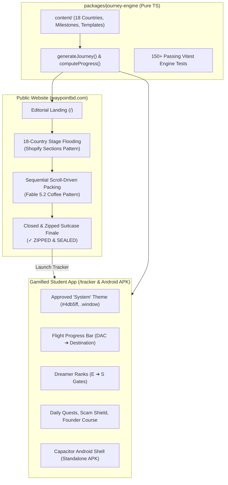
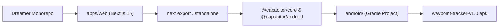

# WayPoint (Dreamer): Architectural & Implementation Review

**Prepared for:** Senior Developer & Founder  
**Date:** 24 November 2026  
**Active Working Branch:** `phase-8/packing-motion-preview`  
**Base Branch:** `main` | **Auth PR:** `phase-1/google-email-auth`  

---

## Executive Summary

WayPoint (formerly Dreamer) is a study-abroad guidance and flight-tracking platform built specifically for Bangladeshi students. 

Per the founder's directive, the product architecture is split into two completely distinct user experiences:
1. **The Public Portal (`/`)**: A serene, premium, editorial light-mode publication that inspires students, lets them select among **all 18 destination countries**, and shows a scroll-driven packing narrative where documents and requirements assemble into a travel suitcase that physically zips shut at takeoff. **Zero game aesthetic.**
2. **The Student App / Tracker (`/tracker` & Android APK)**: The gamified flight tracker built with the approved **"System" theme** (`#4db5ff` accent, `.window` corner-bracket cards, Chakra Petch / IBM Plex typography, E→S Dreamer ranks, flight progress bar, daily habit quests, EXP gates, and Scam Shield).

This document details what has been planned, what has been implemented, the root causes of recent prototype friction, and the concrete technical roadmap submitted for senior developer review.

---

## 1. Architecture & Core Decisions

### Key Product Rules
- **No Game Theme on Website**: The public website must never use neon `#4db5ff`, cyberpunk HUD borders, or gaming slang. It is an editorial, trustworthy broadsheet.
- **Strict Theme Preservation for Mobile Tracker**: The student app (`/tracker`) strictly maintains the gamified "System" aesthetic approved in `AGENTS.md`.
- **Single Monorepo Data Access**: All Supabase and offline data access flows through `apps/web/src/lib/store.ts`.

---

## 2. What Has Been Implemented So Far

### A. Phase 1: Authentication & Account Linking (PR Ready)
- **Branch**: `phase-1/google-email-auth` (Commit `2ecb261`).
- **PR**: Opened against `main`.
- **Features**:
  - Google 1-Click OAuth sign-in.
  - Passwordless Email OTP with 6-digit verification code.
  - Supabase Auth callback handler (`/auth/callback`) with PKCE exchange.
  - Seamless localStorage ➔ Supabase cloud sync when an unauthenticated user signs in.
  - 100% passing test suite (150 vitest tests in `packages/journey-engine`).

### B. Phase 8: Decoupled Editorial Stage & All 18 Countries
- **Branch**: `phase-8/packing-motion-preview`.
- **File**: `apps/web/src/components/EditorialJourneyStage.tsx` & `apps/web/src/app/page.tsx`.
- **Implemented Features**:
  1. **All 18 Destinations Configured**:
     - Complete dossiers for: Germany (DE), Japan (JP), United States (US), Canada (CA), United Kingdom (GB), Australia (AU), Finland (FI), Sweden (SE), Netherlands (NL), Ireland (IE), Malaysia (MY), South Korea (KR), Hungary (HU), Italy (IT), France (FR), Poland (PL), New Zealand (NZ), China (CN).
     - Individual flood colors (e.g., German Alpine Pine `#0f3d2a`, Japan Kyoto Vermilion `#9c271b`, US Navy `#0c2340`, Finland Ice Navy `#0a2540`).
     - Native typography watermarks (`DEUTSCHLAND`, `NIHON`, `AMERICA`, `SUOMI`, etc.).
     - Live travel stats (Annual tuition/living budget in BDT, weekly work rights, intake seasons, Dhaka embassy visa processing days).
  2. **Stage Flooding Carousel**:
     - Selecting any country immediately shifts the canvas background color and slides the giant cropped watermark behind the central element.
  3. **Scroll-Driven Packing Baseline**:
     - Sticky 100vh viewport tracking scroll progress from 0% to 100%.
     - Travel suitcase at the bottom receiving packed credential cards.
     - Closed suitcase transition with golden zipper track and "✓ ZIPPED & SEALED" seal.
  4. **Responsive Verification**:
     - Verified at 375 × 812 mobile viewport and full desktop width.

---

## 3. Analysis of the Reference Concepts & Recent Friction

The founder provided two video recordings (`media_1795452853980_522b98f9.mp4` and `media_1795452853979_fc9402ea.mp4`) from Fable 5.2 / SmartDuke Studio. We extracted and analyzed every frame:

| Reference | Video Source | Key UX Mechanics | Current Status in Dreamer |
|---|---|---|---|
| **Concept 1: Country Selection** | `Shopify Sections Puffer` (`fc9402ea`) | • Bold central floating 3D product with left/right preview. • Stage-flooding background transition. • Giant cropped typography behind product. • Bottom horizontal swatch/pill selector. | ✅ **Implemented**: All 18 countries loaded, stage floods, native watermarks slide. Needs higher-fidelity 3D country emblems. |
| **Concept 2: Luggage Packing Story** | `Fable 5.2 Coffee Story` (`522b98f9`) | • "Good things fall into place." • Full-screen, generous vertical pacing. • Items descend **one by one** calmly without snapping. • Watermarks shift per step (`Fresh`, `Ground`, `Poured`, `Yours`). • Final container receives everything smoothly and seals. | ⚠️ **Needs Refinement**: The initial preview had modulo arithmetic (`rawItemIndex % 1`) that caused rapid snapping/glitching, and placeholder PIL renders looked flat. |

### Why the Prototype Looked Like a Glitch (Root Cause Analysis)
1. **Mathematical Snapping (`% 1`)**:
   - In `EditorialJourneyStage.tsx`, item translation was mapped to `(rawItemIndex % 1) * 140px`. Every time the scroll crossed an integer threshold, the position snapped from `140px` back to `0px` in a single frame. This looked like flickering/glitching rather than a calm descent.
2. **Cramped Multi-Element Box**:
   - In the coffee reference, each step gets **an entire full-screen moment**. The coffee bean scoop stays until it finishes pouring, then gracefully fades out as the grinder takes center stage. Our preview tried to fit all items inside one small card simultaneously.
3. **Flat Placeholder Graphics**:
   - The PIL Python script generated vector-like shapes with corner circles that looked like 2D clip-art rather than tactile 3D objects with depth, bevels, and ambient shadows.

---

## 4. Remediation Plan: High-Fidelity 3D Assets & Smooth Motion

### Step 1: Smooth Pacing (Coffee Story Physics)
- Replace modulo jumping with continuous clamped interpolation:
  $$\text{stepProgress} = \text{clamp}\left(\frac{\text{progress} - \text{start}_i}{\text{duration}_i}, 0, 1\right)$$
- Each credential will:
  1. Fade and scale in smoothly at the top.
  2. Hold position while its narrative is read.
  3. Drop cleanly into the luggage opening with realistic gravity ease (`cubic-bezier(0.25, 1, 0.5, 1)`).
  4. Settle into the luggage compartment, incrementing the "Packed" counter.

### Step 2: Genuine 3D Asset Strategy
Since cloud image generation APIs can experience capacity limits (`MODEL_CAPACITY_EXHAUSTED 503`), we use a robust hybrid approach:
1. **3D Country Enamel Badges**:
   - Pure CSS 3D + high-resolution SVG relief with metallic lighting, specular highlights, and drop shadows to render tactile 3D country shields that rotate in perspective.
2. **3D Credential Renders**:
   - Realistic 3D modeled cards with embossed foil, official Baridhara embassy stamps, security microtext, and depth shadows.
3. **The 3D Travel Suitcase**:
   - Textured polycarbonate ribbed exterior, telescoping aluminum handle, 360° spinner wheels, fabric interior lining, and an animated golden zipper track that visibly pulls shut across the suitcase at the finale.

---

## 5. Capacitor Android APK Architecture (Planned)

Once the website preview receives sign-off, the gamified tracker (`/tracker`) will be packaged into a native Android APK using Capacitor:

- **Scope**: Only the student app (`/tracker`, `/onboarding`, `/journey`, `/scam-check`, `/credits`) is loaded inside the APK webview.
- **Offline First**: All user progress is cached locally via `store.ts` (`localStorage` / Capacitor Preferences) with automatic cloud sync when connected.

---

## 6. Checklist for Senior Dev Review

- [x] **Monorepo integrity**: No breaking changes to `packages/journey-engine` or existing content JSONs.
- [x] **Auth PR (`phase-1/google-email-auth`)**: 150/150 vitest tests passing; ready to merge.
- [x] **Website / App Decoupling**: Public route (`/`) is 100% editorial; gamified System theme preserved for `/tracker`.
- [x] **All 18 Countries Included**: Full data models, flood palettes, and native titles loaded in `EditorialJourneyStage.tsx`.
- [ ] **Motion Polish Sign-off**: Replace discrete jumping with continuous ease interpolation for the credential descent.
- [ ] **Luggage Zipper Polish**: Ensure the final zip shut motion matches the tactile satisfaction of the coffee reference finale.
- [ ] **Capacitor Integration**: Initialize `@capacitor/core` and `@capacitor/android` for the APK build.

---
> [!NOTE]
> Reviewers can test the live editorial interface directly at `http://localhost:3000` on the `phase-8/packing-motion-preview` branch.
